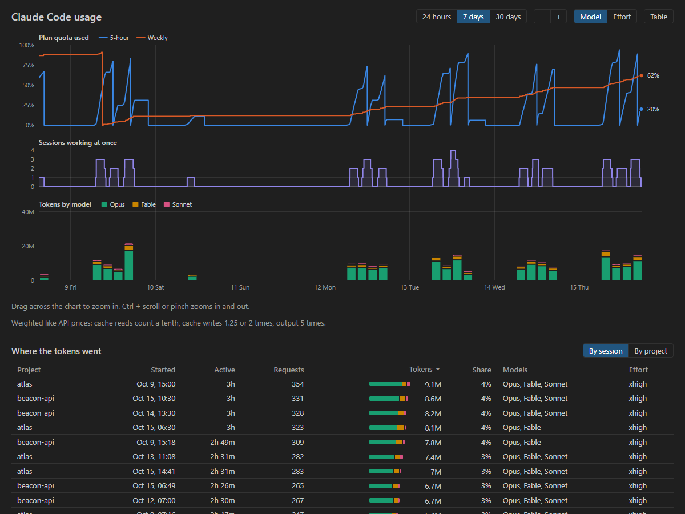
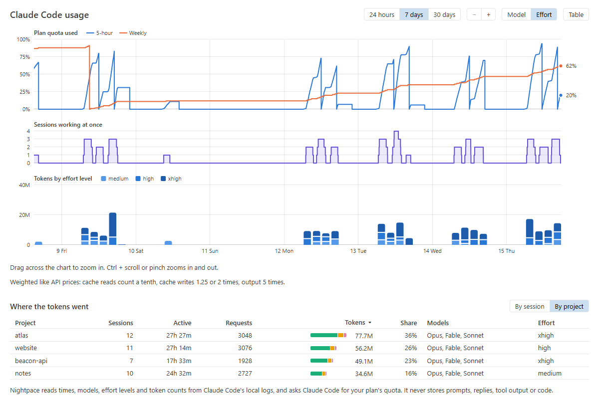

# Nightpace

**See how fast your Claude Code quota burns, and why.**

Nightpace puts your Claude Code usage on one timeline in VS Code: the 5-hour and weekly plan
limits as Claude Code reports them, how many sessions were working at once, and the tokens they
used by model and effort level. Below it, see which sessions and projects used them. The quota
is in the status bar too, so you know where you stand without opening anything.

> **Preview.** The timeline, the session list and the status bar work today. Forecasts from your
> own history (_"three xhigh sessions run out on Thursday; two last until Sunday"_) are next.

## Why Nightpace

- **History, not just a number.** A status bar percentage tells you where you are. Nightpace
  records the quota every few minutes and shows how it got there, next to what you were doing.
- **Parallel sessions in view.** See when two, three or four sessions were working at once and
  what that did to the 5-hour window.
- **Model and effort level.** Split the token columns by model or by effort level to see what an
  xhigh afternoon costs next to a medium one.
- **Private.** Reads usage metadata from Claude Code's local logs; never stores prompts, replies,
  tool output or code. No telemetry, and Nightpace itself makes no network requests.

## Features

### Timeline

Run **Nightpace: Show Timeline** from the Command Palette for the last 24 hours, 7 days or 30
days on one time axis:

- **Plan quota used:** the 5-hour and weekly limits, as Claude Code reported them while Nightpace
  was recording.
- **Sessions working at once:** a session counts as working until it has been quiet for 5
  minutes.
- **Tokens:** by model or by effort level, weighted the way API prices weigh them (cache reads
  count a tenth, cache writes 1.25 or 2 times, output 5 times), so a column shows cost rather
  than raw cache reads.

Hover or use the arrow keys for every value at a time, or switch to a table. Drag across the
chart, Ctrl + scroll or pinch to zoom into part of the range; columns get finer as you zoom in,
down to a minute.

### Where the tokens went

Below the timeline, the sessions or projects of the period shown: when each session started,
how long it worked, its requests, tokens and share, and the models and effort levels it used.
Sort by any column.

### Status bar

Your plan's 5-hour and weekly usage and when the 5-hour window resets, like
`5h 63% · Wk 41% · ↻14:02`, turning yellow at 80% and red at 95%. Hover for per-model weekly
limits. Click to open the timeline.

## Getting started

1. Use [Claude Code](https://claude.com/product/claude-code) in VS Code (the Claude Code extension) or in a
   terminal on the same machine.
2. Install Nightpace. It starts reading Claude Code's logs and recording the quota right away.
3. Run **Nightpace: Show Timeline**.

Tokens and sessions show from the logs Claude Code has kept (by default the last 30 days). The
quota line starts when Nightpace is installed, since Claude Code keeps no quota history.

## Privacy

Nightpace reads usage metadata (timestamps, session IDs, models, effort levels, token counts and
the folder each session ran in) from Claude Code's local session logs. It never stores your
prompts, Claude's replies, tool output or source code. It keeps that metadata in VS Code's
storage for the extension, so your history outlasts Claude Code deleting old logs and opens
without reading them all again.

For the quota, Nightpace asks Claude Code: every 5 minutes while you work and hourly otherwise,
it starts Claude Code briefly and asks for the plan's usage, the same request the Claude Code
extension makes for its own usage view. Claude Code gets the numbers from Anthropic. No prompt
is sent, no quota is used, and Nightpace never reads your credentials.

- Turn quota recording off with the `nightpace.quota.enabled` setting.
- **Nightpace: Delete Recorded Data** deletes everything Nightpace has kept.
- No telemetry. Nightpace itself makes no network requests.

## Limitations

- **Plan limits need a Claude subscription** (Pro, Max, Team). With an API key, Bedrock or
  Vertex there is no plan quota; tokens and sessions still show.
- **The quota is per account, the logs are per machine.** Claude Code on another computer and
  Claude on the web use the same quota but don't appear in the token columns here.
- **Weighted tokens are not quota.** Anthropic doesn't publish how usage counts against the
  limits; the weighting follows API prices. Measuring it from your own history is the next step.
- **The quota request is not a documented Claude Code API.** If a Claude Code update changes it,
  the quota line pauses until Nightpace is updated; tokens and sessions keep working.
- Subagents' logs often record only part of their output tokens, so their share can be low.

## Contributing

Bug reports, ideas and pull requests are welcome; see [CONTRIBUTING.md](CONTRIBUTING.md). Please
don't attach Claude Code session logs to issues: they contain your prompts and code.

## License

[MIT](LICENSE) © MBK Dev Studio. Third-party notices: [THIRD_PARTY_NOTICES.md](THIRD_PARTY_NOTICES.md).

Nightpace is not affiliated with or endorsed by Anthropic. Claude and Claude Code are trademarks
of Anthropic.
